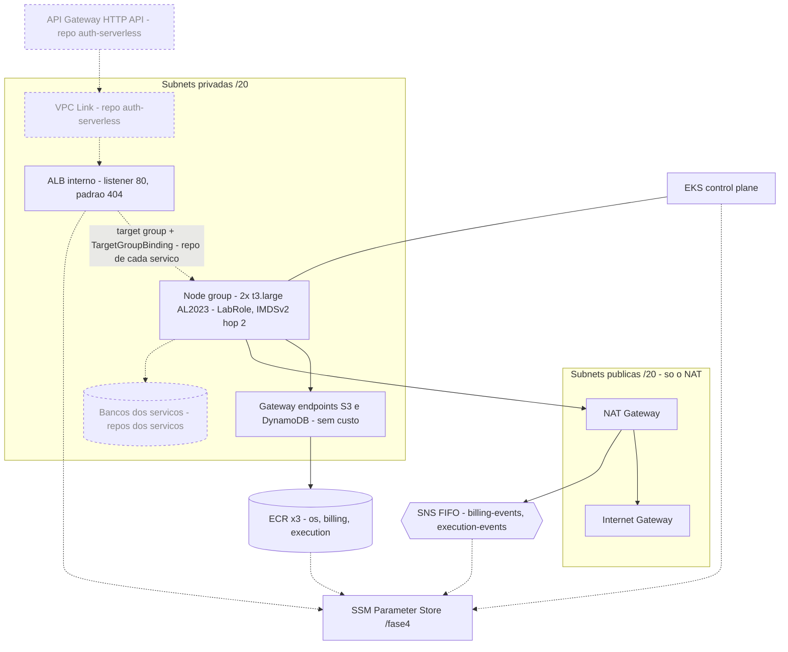

# fiap-fase4-infra-k8s — plataforma: VPC + EKS + ECR + ALB interno + SNS (Terraform)

Plataforma da Fase 4 do Tech Challenge (FIAP SOAT): a oficina mecânica em **três microsserviços** — OS, Billing e
Execution — coordenados por uma Saga orquestrada. É o **primeiro da ordem de deploy**: sem a rede, o cluster, os
registries, o ALB interno e os tópicos daqui, nada mais sobe.

```
infra-k8s  ──►  infra de cada serviço  ──►  deploy dos serviços  ──►  auth-serverless
(você está aqui)  banco, filas, regra no ALB    pipeline → EKS           API Gateway + Lambda
```

O que este repositório provisiona:

- **VPC** em 2 AZs: subnets públicas (só o NAT), subnets privadas (todo o resto), 1 NAT Gateway e *gateway
  endpoints* de **S3** e **DynamoDB**;
- **EKS** com node group gerenciado de **2× t3.large** (AL2023) nas subnets privadas, com a **`LabRole`** como role
  dos nós e um *launch template* próprio (IMDSv2 com *hop limit* 2, crédito de CPU `unlimited`, disco gp3);
- **ECR ×3**: `os-service`, `billing-service`, `execution-service`;
- **ALB interno** com listener HTTP (resposta padrão **404**) e security group próprio — a porta de entrada dos
  serviços, alcançável só de dentro da VPC;
- **tópicos SNS FIFO** `billing-events.fifo` e `execution-events.fifo` — o contrato público de eventos da Saga;
- os **parâmetros SSM `/fase4/*`** que os outros repositórios consomem.

E instala no cluster, por script (não por Terraform): o **AWS Load Balancer Controller** (só para
`TargetGroupBinding`) e o **`nri-bundle`** do New Relic.

> 📖 Este repositório é só infraestrutura e não expõe API própria. A API de cada serviço está no repositório dele;
> a arquitetura geral está em
> [fiap-fase4-os-service/docs/arquitetura](https://github.com/CleytonOngaratto/fiap-fase4-os-service/tree/main/docs/arquitetura).

## Arquitetura

Linha cheia = provisionado por **este** repositório. Tracejado = criado pelos outros repositórios, sobre a rede e os
parâmetros daqui.



Tudo dentro dos dois boxes vive na **VPC `10.0.0.0/16`** (`us-east-1`), uma subnet de cada tipo por AZ. `EKS`,
`ECR`, `SNS` e `SSM` são serviços regionais, fora da VPC: os nós os alcançam pelo NAT (ECR e S3/DynamoDB pelos
*gateway endpoints*, que tiram o `docker pull` e o tráfego do DynamoDB do caminho pago do NAT).

**Nenhum load balancer público.** A entrada é API Gateway → VPC Link → ALB interno → pods. Quem é dono de quê:

| Peça | Dono |
|---|---|
| ALB interno, listener (padrão 404) e security group do ALB | **este repositório** (publica `/fase4/alb/*`) |
| Target group (`ip`), regra de path no listener e `TargetGroupBinding` | repositório de **cada serviço** |
| VPC Link, integrações e rotas explícitas por serviço | `fiap-fase4-auth-serverless` |

O AWS Load Balancer Controller existe só para ligar os pods aos target groups (`TargetGroupBinding`); ele não cria
load balancer, não atende `Ingress` e não intercepta `Service` do tipo `LoadBalancer`. Quando um binding existe, o
próprio controller abre no security group do cluster a porta do pod **só a partir do SG do ALB** — e a remove quando
o binding é apagado.

**Credencial AWS dos pods.** Os pods publicam no SNS, consomem do SQS e gravam no DynamoDB **sem nenhuma credencial
configurada**: a `LabRole` é a role do node group e o *launch template* sobe o *hop limit* do IMDSv2 para 2, para a
resposta do serviço de metadados chegar até o pod. É uma restrição do AWS Academy (sem IRSA nem Pod Identity) — ver
[ADR-002](https://github.com/CleytonOngaratto/fiap-fase4-os-service/blob/main/docs/arquitetura/adr/ADR-002-credencial-dos-pods.md).

## Pré-requisitos

| Ferramenta | Versão | Observação |
|---|---|---|
| Terraform | **1.15.4** (`>= 1.11`) | `>= 1.11` por causa do lock nativo do backend S3 (`use_lockfile`) |
| AWS CLI | v2 | credenciais **temporárias** do Learner Lab (com `aws_session_token`) |
| kubectl | **1.35** | compatível com o EKS 1.34–1.36 (política de ±1 versão) |
| helm | **3.21** | instala o controller e o `nri-bundle` |
| gh | qualquer | só para `scripts/refresh-gh-secrets.ps1` |

## Uso

### 1. Preflight — **sempre**, antes de qualquer apply

```powershell
.\scripts\preflight.ps1
```

Responde em segundos o que custaria um apply de 20 minutos: a sessão do lab está viva? Qual é a
`LabEksClusterRole` desta instância do lab (o sufixo muda a cada reset)? A `LabRole` confia em `ec2.amazonaws.com` e
tem `AmazonEKSWorkerNodePolicy` e `AmazonEC2ContainerRegistryReadOnly`? O `ssm:PutParameter` funciona?

Anote o `cluster_role_name` que ele imprimir.

### 2. Backend remoto — uma vez por conta

```powershell
.\scripts\bootstrap-backend.ps1     # cria o bucket fiap-fase4-tfstate-<account> e gera backend.hcl
```

### 3. Aplicar

O caminho normal é o **CI** (ver [CI/CD](#cicd)): merge na `main` que mude Terraform, ou `workflow_dispatch`
`apply`. Localmente, para iterar:

```powershell
Copy-Item terraform.tfvars.example terraform.tfvars          # e preencha cluster_role_name
terraform init "-backend-config=backend.hcl" -lockfile=readonly
terraform plan -out tfplan                                   # não cria nada e não custa nada
terraform apply tfplan                                       # ~20 min · a partir daqui: ~US$ 0,34/h
```

> O `plan` já é um teste de verdade: resolve os `data "aws_iam_role"` contra a AWS e prova que as roles existem com os
> nomes configurados — sem criar recurso nenhum.

> **PowerShell:** sem aspas, o `-backend-config=backend.hcl` é quebrado no `=` e o Terraform recebe dois argumentos.

### 4. Configurar o CI (uma vez por sessão)

```powershell
.\scripts\refresh-gh-secrets.ps1 -Org <dono> -ClusterRoleName <do preflight> -StateBucket <do bootstrap>
```

Os três secrets da sessão vão por **stdin** para o `gh` — nunca na linha de comando, onde apareceriam na lista de
processos.

### 5. Kubeconfig e instalações no cluster

```powershell
aws eks update-kubeconfig --region us-east-1 --name fiap-fase4-eks
.\scripts\install-lb-controller.ps1     # AWS Load Balancer Controller (só TargetGroupBinding)
.\scripts\install-newrelic-k8s.ps1      # nri-bundle (license key lida do SSM)
```

> ⚠️ **Antes do controller, sincronize o relógio** (`w32tm /resync` num PowerShell de administrador). O Helm gera o
> certificado do webhook com a hora **local**: com o relógio adiantado, o certificado nasce "no futuro" e o API
> server o recusa (`x509: certificate ... not yet valid`) até a hora real alcançar. O script mede a diferença contra
> a hora da AWS e aborta acima de 30 s.

Os dois scripts leem o nome do cluster e o ID da VPC do SSM e recusam rodar se o contexto do `kubectl` apontar para
outro cluster.

## Contrato entre repositórios (SSM Parameter Store)

Nada de ARN, endpoint, DNS ou URL hardcodado entre repositórios, e nada de `terraform_remote_state`: o state carrega
tudo em texto plano. Cada repositório publica o que cria e lê o que precisa.

| Parâmetro | Conteúdo | Consumido por |
|---|---|---|
| `/fase4/vpc/id` · `/fase4/vpc/cidr` | ID e CIDR da VPC | infra dos serviços, `auth-serverless` |
| `/fase4/vpc/private-subnets` · `/fase4/vpc/public-subnets` | IDs (StringList) | infra dos serviços, `auth-serverless` |
| `/fase4/eks/cluster-name` | nome do cluster | pipelines dos serviços, scripts deste repositório |
| `/fase4/eks/cluster-endpoint` | endpoint da API | diagnóstico |
| `/fase4/eks/node-sg-id` | **security group primário do cluster** | infra dos serviços (SG dos bancos) |
| `/fase4/ecr/{os,billing,execution}/repo-url` | URL do repositório de imagem de cada serviço | pipeline de cada serviço |
| `/fase4/sns/{billing-events,execution-events}/topic-arn` | ARN de cada tópico FIFO | infra e configuração dos serviços |
| `/fase4/alb/listener-arn` | listener HTTP do ALB interno | infra dos serviços (regra de path), `auth-serverless` (integração do VPC Link) |
| `/fase4/alb/sg-id` | security group do ALB | pipeline de cada serviço (`networking` do `TargetGroupBinding`), `auth-serverless` (saída do SG do VPC Link) |
| `/fase4/alb/dns` | DNS do ALB, **só host** (sem esquema nem porta) | diagnóstico e testes de dentro da VPC |

> `node-sg-id` é o `cluster_security_group_id`: o *launch template* não declara security group, e nesse caso o EKS
> aplica o SG do cluster às instâncias. Publicar outro valor aqui faria os bancos recusarem conexão dos pods, com
> sintoma de timeout que parece problema de rede.

Os parâmetros de **bootstrap** (chaves do JWT, *pepper* de senha, chaves do New Relic e do Mercado Pago) não são
deste repositório: são publicados à mão, uma vez, e sobrevivem ao `destroy`.

## Verificação (Definition of Done)

```powershell
aws eks update-kubeconfig --region us-east-1 --name fiap-fase4-eks
kubectl get nodes -L node.kubernetes.io/instance-type      # 2 nós Ready, t3.large

$ids = aws ec2 describe-instances --region us-east-1 `
  --filters "Name=tag:eks:nodegroup-name,Values=fiap-fase4-ng" "Name=instance-state-name,Values=running" `
  --query "Reservations[].Instances[].InstanceId" --output text
aws ec2 describe-instances --region us-east-1 --instance-ids $ids.Split() `
  --query "Reservations[].Instances[].[InstanceId,MetadataOptions.HttpTokens,MetadataOptions.HttpPutResponseHopLimit]" --output table
aws ec2 describe-instance-credit-specifications --region us-east-1 --instance-ids $ids.Split() --output table   # unlimited

kubectl -n kube-system get deploy aws-load-balancer-controller                   # 2/2
aws ssm get-parameters-by-path --path /fase4 --recursive --query "Parameters[].Name"
```

**Credencial dos pods** — um pod sem credencial nenhuma tem de se apresentar como a `LabRole`:

```powershell
kubectl run cred-probe --rm -i --restart=Never --image=public.ecr.aws/aws-cli/aws-cli `
  --env=AWS_REGION=us-east-1 -- sts get-caller-identity --query Arn --output text
```

**ALB interno** — responde 404 de dentro da VPC e não responde de fora:

```powershell
$dns = aws ssm get-parameter --name /fase4/alb/dns --query Parameter.Value --output text
kubectl run alb-probe --rm -i --restart=Never --image=public.ecr.aws/aws-cli/aws-cli --command -- `
  curl -s -o /dev/null -w "%{http_code}" "http://$dns/"                           # 404
curl.exe -m 10 "http://$dns/"                                                    # sem conexão (timeout)
```

## CI/CD

[`.github/workflows/terraform.yml`](.github/workflows/terraform.yml):

| Gatilho | O que roda |
|---|---|
| `pull_request` → `main` | `fmt-validate` (`fmt -check` + `init -backend=false` + `validate`, **check obrigatório**) e `terraform` (`plan`, **nunca aplica**) |
| `push` → `main` **com mudança de Terraform** | `fmt-validate` e `terraform` (`plan -out` → `apply` do plano salvo) |
| `workflow_dispatch` | `plan` \| `apply` \| `destroy` — o `destroy` é a alavanca de custo entre sessões |

**Regras de merge:**

- **o merge aplica.** Qualquer mudança em `**.tf`, no `.terraform.lock.hcl` ou no próprio workflow sobe (ou altera)
  a plataforma ao entrar na `main` — então esse merge só com a sessão do lab ligada e com `destroy` + auditoria na
  mesma sessão;
- **merge só de script, values ou `.md` não aplica** (filtro `paths` no `push`);
- correção depois do merge entra em **PR novo**, nunca direto na `main`;
- o `pull_request` não tem filtro de caminho de propósito: um workflow pulado por filtro deixa o check obrigatório
  em "Pending" e trava o merge.

O job `terraform` depende da credencial temporária do lab: com o lab desligado ele fica **vermelho** — por isso
**não** é check obrigatório (só o `fmt-validate` é). Ele roda em fila (`concurrency` fixo, sem cancelar o que está
em curso): abortar um `apply` no meio deixaria recursos fora do state. Com um job rodando e outro pendente, um terceiro
evento cancela o pendente — espere o `plan` do PR terminar antes de mergear.

O workflow precisa de **cinco valores no repositório**, nenhum com default:

| Nome | Tipo | Origem | Muda quando |
|---|---|---|---|
| `AWS_ACCESS_KEY_ID` | secret | painel *AWS Details* do Learner Lab | a cada sessão (~4h) |
| `AWS_SECRET_ACCESS_KEY` | secret | idem | a cada sessão |
| `AWS_SESSION_TOKEN` | secret | idem — sem ele o erro vem como `InvalidClientTokenId`, que parece chave errada | a cada sessão |
| `TF_STATE_BUCKET` | variable | `scripts/bootstrap-backend.ps1` | uma vez por conta |
| `CLUSTER_ROLE_NAME` | variable | `scripts/preflight.ps1` | **a cada reset do lab** |

> ⚠️ **Secret e variable têm de ser de _repositório_**, não de *Environment*: o workflow não declara `environment:`.

## Custo e destruição

| Item | US$/h |
|---|---|
| Control plane EKS | 0,100 |
| 2× t3.large On-Demand | 0,166 |
| NAT Gateway (+ IPv4 público do EIP) | 0,050 |
| ALB interno | ~0,023 + LCU |
| SNS, gateway endpoints | ~0 (por uso; endpoints grátis) |
| **Total** | **≈ 0,34** (~US$ 8/dia) |

As t3.large rodam em crédito `unlimited`: o uso médio acima de 30% de CPU custa US$ 0,05 por vCPU-hora, cobrado quando
a instância termina — centavos numa sessão normal; com `standard`, o nó novo ficaria preso a 30% de CPU no boot das
JVMs.

> **O painel de budget do lab atrasa 8 a 12 horas** e estourar o budget **desativa a conta e apaga tudo**. Use a
> tabela acima como sinal, nunca o painel. O control plane cobra mesmo com a sessão do lab encerrada: destruir entre
> sessões é obrigação.

**Ordem de subida:** plataforma (este repositório) → infra de cada serviço (`terraform/` de os, billing e execution:
banco, target group e regra no ALB) → deploy dos serviços (pipeline de cada um) → borda (`session/` do
`auth-serverless`; o `persistent/` sobe uma vez por conta do lab).

**Ordem de destruição:** borda de sessão (o API Gateway persistente fica) → `TargetGroupBinding`s e controller →
infra de cada serviço → plataforma. O controller tem de estar vivo quando os bindings são apagados: é ele quem remove
as regras de security group que criou.

### `destroy-all.ps1` — teardown na ordem, com auditoria no fim

[`scripts/destroy-all.ps1`](scripts/destroy-all.ps1), nesta ordem:

1. **confere o contexto do `kubectl`** se o cluster existir — e **recusa rodar**, sem destruir nada, se ele não for o
   cluster da Fase 4;
2. `terraform destroy` do root **`session/`** do `fiap-fase4-auth-serverless` (VPC Link, integração e rotas). O root
   **`persistent/`** (o HTTP API, a stage e o log group) **nunca** entra: a URL dele está configurada no painel do
   Mercado Pago;
3. **limpa o cluster**: Services `LoadBalancer`, todos os `TargetGroupBinding`s (com o controller vivo) e depois
   `helm uninstall` do `nri-bundle` e do controller;
4. `terraform destroy` do `terraform/` do **os** (RDS, target group, regra no ALB), do **billing** e do **execution**;
5. `terraform destroy` da **plataforma** (este repositório);
6. **confere a conta categoria por categoria** — EKS, EC2, NAT, RDS, snapshots, ELB v1/v2, target groups, VPCs
   não-default, EIPs, ENIs, EBS, ECR, API Gateways, VPC Links, Lambdas, SGs, SNS, SQS, DynamoDB e launch
   templates — e sai com código diferente de zero se sobrou qualquer coisa. A API persistente e o log group dela
   aparecem à parte, como **persistentes por desenho**, e não contam como sobra.

Cada destroy roda `terraform init` com o lock versionado intocado e precisa do `backend.hcl` local do root
(gitignored, criado a partir do `backend.hcl.example` de cada um); um root sem `backend.hcl` é pulado com aviso, e a
auditoria acusa o que sobrar. O `cluster_role_name` vem do `terraform.tfvars` ou de `TF_VAR_cluster_role_name`; sem os
dois, o script descobre a `LabEksClusterRole` na conta — e aborta, antes de mexer em qualquer coisa, se não achar.

```powershell
.\scripts\destroy-all.ps1              # confirma antes de agir
.\scripts\destroy-all.ps1 -Force       # sem confirmação
.\scripts\destroy-all.ps1 -AuditOnly   # só a auditoria, sem destruir nada
```

O bucket de state, os parâmetros de bootstrap do SSM e o `/fase4/apigw/*` do `persistent/` sobrevivem por desenho; os tópicos SNS **somem** com a
plataforma e voltam no próximo `apply`. Os recursos do próprio laboratório (as Lambdas e o tópico `RedshiftSNS` que
vêm em toda conta) ficam fora da auditoria.

Na retomada, `.\scripts\session-start.ps1` imprime a ordem e valida o estado da conta.

## Decisões (resumo)

Detalhamento na documentação arquitetural,
[`fiap-fase4-os-service/docs/arquitetura/`](https://github.com/CleytonOngaratto/fiap-fase4-os-service/tree/main/docs/arquitetura):
[ADR-002 — credencial AWS dos pods](https://github.com/CleytonOngaratto/fiap-fase4-os-service/blob/main/docs/arquitetura/adr/ADR-002-credencial-dos-pods.md)
e [ADR-003 — borda privada](https://github.com/CleytonOngaratto/fiap-fase4-os-service/blob/main/docs/arquitetura/adr/ADR-003-borda-privada.md).
Continuam valendo, da fase anterior:
[contrato por SSM](https://github.com/CleytonOngaratto/fiap-fase3-app/blob/main/docs/arquitetura/adr/ADR-001-ssm-vs-terraform-remote-state.md),
[API do cluster pública](https://github.com/CleytonOngaratto/fiap-fase3-app/blob/main/docs/arquitetura/adr/ADR-004-api-do-cluster-publica.md)
e [VPC em recursos crus](https://github.com/CleytonOngaratto/fiap-fase3-app/blob/main/docs/arquitetura/adr/ADR-005-vpc-em-recursos-crus.md).

| Decisão | Motivo |
|---|---|
| Workloads só em subnet privada; públicas só com o NAT | nenhum nó, pod ou load balancer com IP público; o control plane também usa só as privadas |
| 1 NAT (não 1 por AZ) | perde HA de saída, aceitável num ambiente destruído entre sessões |
| *Gateway endpoints* S3 e DynamoDB | grátis; tiram o `docker pull` e o tráfego do DynamoDB do caminho pago do NAT |
| `LabRole` no node group + IMDSv2 com *hop limit* 2 | o lab nega IRSA e Pod Identity; é a única credencial de pod que não expira com a sessão ([ADR-002](https://github.com/CleytonOngaratto/fiap-fase4-os-service/blob/main/docs/arquitetura/adr/ADR-002-credencial-dos-pods.md)) |
| 2× `t3.large` em crédito `unlimited` | 3 JVMs com agente New Relic e réplicas mínimas não cabem em t3.medium; `standard` estrangularia o boot |
| `node_max_size = 3` | folga para o rolling update; o lab permite 9 instâncias/32 vCPU, e **20+ desativam a conta** |
| ALB interno + `TargetGroupBinding` (sem Ingress, sem LB por Service) | um load balancer só, privado, no Terraform; o controller só liga pods a target groups ([ADR-003](https://github.com/CleytonOngaratto/fiap-fase4-os-service/blob/main/docs/arquitetura/adr/ADR-003-borda-privada.md)) |
| Controller com Shield/WAF/WAFv2 desligados | `shield:*` é negado explicitamente à `LabRole` |
| Tópicos SNS **FIFO** na plataforma, filas no repo de cada serviço | o tópico é o contrato público de eventos; ordem por OS e deduplicação de 5 min; deduplicação **não** por conteúdo — o `messageId` do outbox é o id de deduplicação |
| ECR por serviço, com `force_delete` e retenção das últimas 10 imagens | pipeline independente por serviço; o `destroy` não trava em repositório com imagem |
| `cluster_version = null` | a AWS escolhe uma versão em *standard support*; *extended support* custa 6× mais |
| Roles por `data source` | o lab bloqueia `iam:CreateRole`; o control plane usa a `LabEksClusterRole`, os nós a `LabRole` |
| State no S3 com `use_lockfile` | lock nativo desde o Terraform 1.11 — sem tabela DynamoDB para criar e destruir |

## Troubleshooting

| Sintoma | Causa provável / solução |
|---|---|
| `ExpiredToken` / `InvalidClientTokenId` | sessão do lab expirou (~4h). Renove o `~/.aws/credentials` e rode `scripts/refresh-gh-secrets.ps1` |
| `apply` falha em `data "aws_iam_role"` depois de um **reset** do lab | o sufixo da `LabEksClusterRole` mudou. Rode `scripts/preflight.ps1` e regrave a variable `CLUSTER_ROLE_NAME` |
| Pod com `NoCredentials` / `Unable to locate credentials` | o *hop limit* das instâncias não é 2 (o node group subiu sem o *launch template* daqui?). Confira com `describe-instances` → `MetadataOptions` |
| `kubectl` dá `no such host` depois de recriar o cluster | o endpoint mudou e o contexto antigo continua no kubeconfig. Rode de novo `aws eks update-kubeconfig` |
| Cluster criado mas `kubectl` dá **Unauthorized** | `bootstrap_cluster_creator_admin_permissions` dá admin a quem *criou*. Se o apply foi por outro principal: `aws eks create-access-entry` + `associate-access-policy` com `AmazonEKSClusterAdminPolicy` |
| Webhook do controller recusado com `x509: certificate ... not yet valid` | relógio local adiantado na hora do `helm install`. `w32tm /resync` e reinstale com `scripts/install-lb-controller.ps1` |
| Log do controller com `AccessDenied` para `shield:*` ou `wafv2:*` | values sem `enableShield/enableWaf/enableWafv2: false` — use o `k8s/aws-load-balancer-controller/values.yaml` deste repositório |
| `destroy` travado em security group do ALB | regra órfã no SG do cluster apontando para o SG do ALB: algum `TargetGroupBinding` foi apagado com o controller fora do ar. Remova a regra à mão e repita |
| `destroy` travado em subnet/VPC | ENI remanescente de load balancer, Lambda ou VPC Link. Respeite a ordem de destruição acima |
| `Error acquiring the state lock` | lock preso de uma execução interrompida. Descubra o ID no próprio arquivo de lock no S3 (`aws s3 cp s3://<bucket>/infra-k8s/terraform.tfstate.tflock -`) e rode `terraform force-unlock -force <ID>` |
